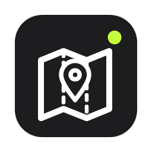
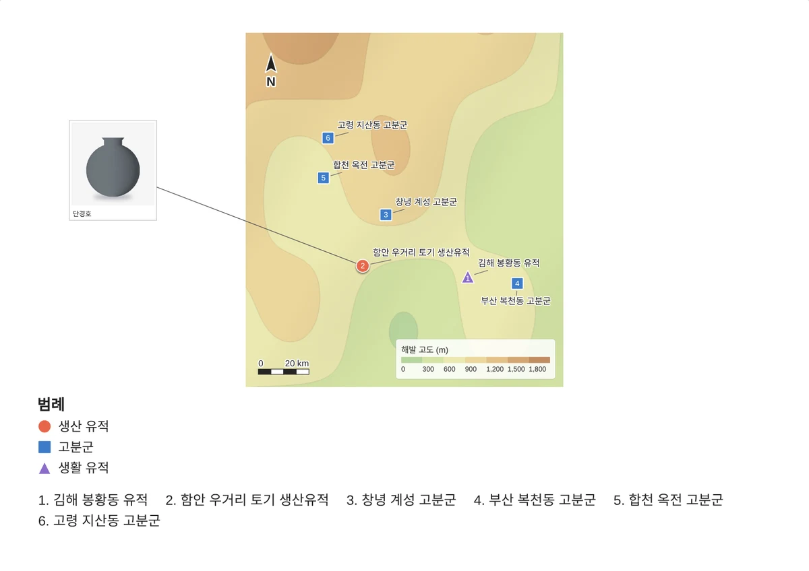
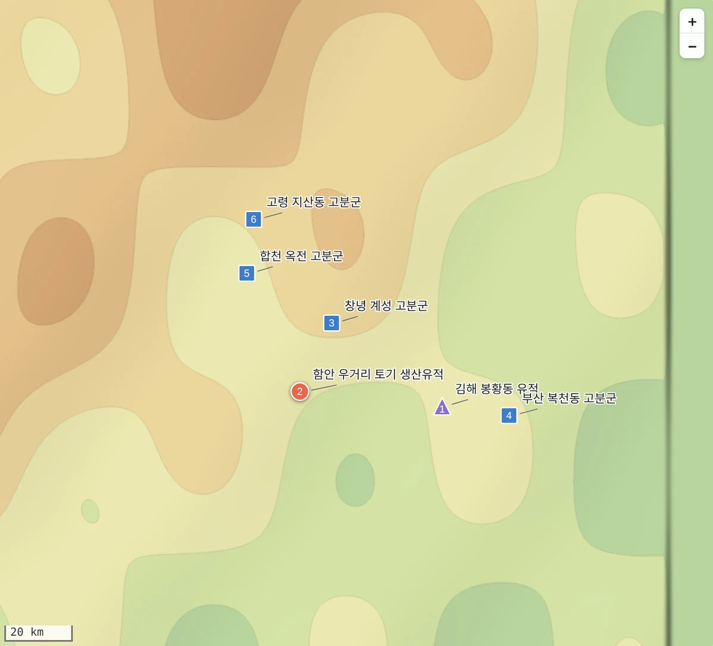

<div align="center">



<h1 align="center">ArchaeoMap</h1>
<h3 align="center">유적 분포도 제작 도구</h3>

<strong>Archaeological Site Map &amp; Plate Maker · 遺跡分布図エディタ</strong>


<sub>日本語をご利用の方は、<a href="#05-english--日本語"><b>05. English / 日本語</b></a> の「日本語」を開いてください。</sub>

<br>

<a href="https://archstudio-hs.github.io/archaeomap/app/"></a><a href="https://github.com/archstudio-hs/archaeomap/releases/latest/download/ArchaeoMap-Windows.exe"></a><a href="https://github.com/archstudio-hs/archaeomap/releases/latest/download/ArchaeoMap-Mac.zip"></a><br><a href="docs/manual.pdf"></a>

</div>

---

## 01. 소개

**ArchaeoMap**은 고고학 연구자를 위한 유적 분포도 제작 프로그램입니다.

유적을 검색해 지도에 표시하고, 그룹별 기호·번호·유적명을 꾸민 뒤, 범례·캡션·축척·방위표·유물 사진을 배치해 보고서·논문용 도판으로 저장할 수 있습니다. **유적 찾기부터 도판 출력까지** 하나의 작업 공간에서 처리하도록 설계했습니다.

### 1.1 주요 기능

| 기능 | 설명 |
|:---|:---|
| **유적 찾기** | 한글·영어·중국어·일본어 검색, 통합 유적 DB 약 10만 곳 + 실시간 자료, 출처 간 좌표 대조 |
| **좌표 등록·수정** | 구글 지도에서 복사한 좌표를 붙여넣으면 위도·경도로 바로 입력 |
| **지도 꾸미기** | 표준·흑백·위성·등고선 지도, 그룹별 기호·번호·유적명·굵게, 연결선 |
| **도판 제작** | 본도 범위·미니지도, 여백, 축척·방위표·고도 범례, 범례·캡션, 유물 사진 연결 |
| **고해상도 출력** | SVG·PNG·JPG·TIFF·PDF 저장, 프로젝트 파일 저장·열기 |

### 1.2 작업 과정

<table width="100%">
  <tr>
    <td align="center" width="33%">
      <b>STEP 01</b><br>
      <strong>유적 찾기</strong><br>
      <sub>검색·좌표 등록·그룹 지정</sub>
    </td>
    <td align="center" width="34%">
      <b>STEP 02</b><br>
      <strong>지도 꾸미기</strong><br>
      <sub>배경 지도·기호·글자 설정</sub>
    </td>
    <td align="center" width="33%">
      <b>STEP 03</b><br>
      <strong>도판 편집 및 저장</strong><br>
      <sub>범위·여백·범례·캡션·고해상도 출력</sub>
    </td>
  </tr>
</table>

> **자료 처리 방식**
>
> 유적 검색은 프로그램에 함께 든 통합 유적 DB를 사용자의 컴퓨터에서 먼저 찾고, 공개 자료(국가유산청·UNESCO·Wikidata·OpenStreetMap·Pleiades)를 함께 조회합니다. 이때 보내는 것은 검색어뿐이며, 프로젝트와 사진은 외부로 보내지 않습니다. 지도와 고도 자료는 인터넷에서 받아 옵니다.

---

## 02. 시작하기

### 2.1 이용 방법

| 이용 환경 | 바로가기 | 사용 방법 |
|:---|:---|:---|
| **웹** | **[웹 편집기 열기](https://archstudio-hs.github.io/archaeomap/app/)** | 설치 없이 Chrome·Edge에서 실행 |
| **Windows 10·11** | **[Windows용 다운로드 (.exe)](https://github.com/archstudio-hs/archaeomap/releases/latest/download/ArchaeoMap-Windows.exe)** | 파일을 내려받아 실행 |
| **macOS 11 이상** | **[macOS용 다운로드 (.zip)](https://github.com/archstudio-hs/archaeomap/releases/latest/download/ArchaeoMap-Mac.zip)** | 압축 해제 후 앱을 응용 프로그램 폴더로 이동 |

설치형 버전은 Chrome 또는 Edge 창으로 열리며, 창을 모두 닫으면 몇 분 뒤 스스로 종료됩니다.

> **데스크톱 앱 안내**
>
> Windows·macOS 설치형 버전에는 코드 서명이 적용되지 않아 다운로드 또는 최초 실행 시 보안 경고가 나타날 수 있습니다. 학교·기관 PC에서 앱 실행이 제한되는 경우 웹 버전을 이용할 수 있습니다.

### 2.2 다운로드 및 실행 문제 해결

<details>
<summary><b>Chrome · Edge · Windows · macOS 문제 해결 방법 보기</b></summary>

<br>

**① 브라우저에서 다운로드가 차단되는 경우**

- **Chrome:** 오른쪽 위 다운로드 목록에서 해당 파일의 경고 내용을 확인합니다. 다운로드를 계속할 수 있는 옵션이 표시되는 경우, 공식 GitHub Releases의 파일인지 확인한 뒤 선택합니다.
- **Edge:** 다운로드 목록에서 해당 파일의 `···` 메뉴를 열어 경고 내용을 확인합니다. `유지` 또는 추가 옵션이 표시되는 경우, 파일의 출처를 확인한 뒤 선택할 수 있습니다.

**② Windows에서 실행이 차단되는 경우**

- **Microsoft Defender SmartScreen**에서 `Windows의 PC 보호` 메시지가 나타날 수 있습니다.
- 신뢰할 수 있는 배포 파일인 경우, `추가 정보` 또는 `자세한 정보`를 선택하면 `실행` 옵션이 나타날 수 있습니다.
- **Smart App Control**이나 기관 보안 정책에 의해 차단된 경우에는 웹 버전을 이용하세요.

**③ macOS에서 실행이 차단되는 경우**

1. 압축을 해제한 앱을 `응용 프로그램` 폴더로 옮깁니다.
2. 개발자를 확인할 수 없다는 안내가 나타나면 창을 닫습니다.
3. **시스템 설정 → 개인정보 보호 및 보안**을 엽니다.
4. 해당 앱에 대한 **그래도 열기**가 표시되는 경우 선택하고, 안내에 따라 인증합니다.

**‘앱이 손상되어 열 수 없습니다’라고 나오는 경우**

먼저 공식 [GitHub Releases](https://github.com/archstudio-hs/archaeomap/releases)에서 파일을 다시 내려받아 확인하세요. 다운로드한 파일이 정상이고 macOS의 격리 속성만 문제인 것으로 확인된 경우에 한해, 터미널에서 아래 명령을 사용할 수 있습니다.

```bash
xattr -dr com.apple.quarantine "/Applications/ArchaeoMap.app"
```

이 명령은 macOS의 격리 보호를 해제하므로 주의해서 사용하세요.

**④ 학교·기관 컴퓨터에서 앱 실행이 제한되는 경우**

[웹 편집기](https://archstudio-hs.github.io/archaeomap/app/)를 이용하세요. 단, 기관의 브라우저·보안 설정에 따라 웹 기능도 일부 제한될 수 있습니다.

</details>

### 2.3 다른 환경에서 작업 이어가기

<details>
<summary><b>프로젝트 파일 저장·불러오기</b></summary>

<br>

1. 작업 중인 프로그램에서 맨 위 **저장**을 눌러 프로젝트 파일을 받습니다.
2. 저장한 프로젝트 파일을 다른 컴퓨터나 실행 환경으로 옮깁니다.
3. **프로젝트 → 프로젝트 열기**를 선택해 이어서 편집합니다.

웹 버전과 설치형 버전은 자동 저장이 따로입니다. 프로젝트 파일에는 고른 범위의 지도 영상이 들어 있어, 인터넷이 없어도 같은 도판을 다시 볼 수 있습니다.

</details>

---

## 03. 작업 결과

<table width="100%">
  <tr>
    <th align="center" width="50%">유적 분포도 도판</th>
    <th align="center" width="50%">등고선 지도 작업 화면</th>
  </tr>
  <tr>
    <td align="center" valign="middle">
      <a href="docs/img/plate.webp"></a>
    </td>
    <td align="center" valign="middle">
      <a href="docs/img/map.webp"></a>
    </td>
  </tr>
  <tr>
    <td align="center"><sub>범례·캡션·고도 범례·유물 사진 배치</sub></td>
    <td align="center"><sub>등고선 지도 위 유적 표시</sub></td>
  </tr>
</table>

---

## 04. 사용 환경 및 문서

### 4.1 권장 환경

| 항목 | 지원 및 권장 사항 |
|:---|:---|
| **웹 브라우저** | 데스크톱 Chrome·Edge 최신 버전 |
| **Windows** | Windows 10·11 |
| **macOS** | macOS 11 이상 (Apple 실리콘·인텔) |
| **화면 크기** | 가로 1280px 이상 권장 |
| **인터넷** | 지도·고도 자료와 실시간 검색에 필요 |
| **모바일·태블릿** | 현재 미지원 |

### 4.2 관련 문서

| 문서 | 내용 |
|:---|:---|
| **[사용 설명서 (한국어)](docs/manual.pdf)** | 기능 및 사용 방법 |
| **[操作マニュアル（日本語）](docs/manual-ja.pdf)** | 일본어 사용 설명서 |
| [서드파티 라이선스](THIRD_PARTY_NOTICES.md) | 외부 라이브러리·지도·유적 자료 관련 고지 |
| [라이선스](LICENSE.md) | 프로그램 이용·수정·재배포 조건 |

### 4.3 사용한 지도와 자료

| 구분 | 자료 |
|:---|:---|
| **표준·흑백·등고선 지도** | OpenFreeMap · OpenMapTiles · © OpenStreetMap contributors |
| **위성 지도** | Esri World Imagery (Esri, Maxar, Earthstar Geographics, and the GIS User Community) |
| **고도 자료** | Mapzen Terrain Tiles, AWS Open Data |
| **유적 자료** | 국가유산청 · 일본 국토수치정보(문화재) · UNESCO · Wikidata · OpenStreetMap · Pleiades |

도판을 출력할 때 지도 출처 문구를 뺐다면, 보고서의 도판 설명 등에 출처를 꼭 적어 주세요.

---

## 05. English / 日本語

<details>
<summary><b>English — Introduction</b></summary>

<br>

**ArchaeoMap · Archaeological Site Map &amp; Plate Maker**

ArchaeoMap is a browser-based and desktop tool for making archaeological site distribution maps and publication plates. Search about 100,000 sites in Korean, English, Chinese or Japanese (a bundled database plus live public sources), paste coordinates copied from Google Maps, style symbols and labels by group, choose standard, monochrome, satellite or contour basemaps, set page margins, and export plates with legend, caption, scale bar, north arrow, elevation key and artifact photos as SVG, PNG, JPG, TIFF or PDF.

Only the search term is sent to public sources; projects and photos stay on your device.

**Get started:** [Web editor](https://archstudio-hs.github.io/archaeomap/app/) · [Windows](https://github.com/archstudio-hs/archaeomap/releases/latest/download/ArchaeoMap-Windows.exe) · [macOS](https://github.com/archstudio-hs/archaeomap/releases/latest/download/ArchaeoMap-Mac.zip) · [Manual (Korean)](docs/manual.pdf) · [Manual (Japanese)](docs/manual-ja.pdf)

**Requirements:** Desktop Chrome or Edge recommended; screen width 1280px or greater.

**License:** [PolyForm Strict License 1.0.0](LICENSE.md) — noncommercial use permitted; modification and redistribution are not permitted under the license.

</details>

<details>
<summary><b>日本語 — 概要・ダウンロード・使い方</b></summary>

<br>

### ArchaeoMap

**遺跡分布図エディタ**

ArchaeoMapは、考古学研究者向けの遺跡分布図作成ツールです。遺跡を検索して地図に表示し、グループごとの記号・番号・遺跡名を整えたうえで、凡例・キャプション・縮尺・方位記号・遺物写真を配置して、報告書・論文用の図版として保存できます。

| 主な機能 | 内容 |
|:---|:---|
| **遺跡検索** | 日本語・韓国語・中国語・英語で検索、統合遺跡DB 約10万件＋リアルタイム資料、出典間の座標比較 |
| **座標の登録・修正** | Googleマップでコピーした座標を貼り付けると緯度・経度に自動入力 |
| **地図の整備** | 標準・モノクロ・衛星・等高線地図、グループごとの記号・番号・遺跡名・太字、引き出し線 |
| **図版の作成** | 本図範囲・ミニマップ、余白、縮尺・方位記号・標高凡例、凡例・キャプション、遺物写真 |
| **高解像度出力** | SVG・PNG・JPG・TIFF・PDF、プロジェクトファイルの保存・読み込み |

### ダウンロード・利用方法

<div align="center">

<a href="https://archstudio-hs.github.io/archaeomap/ja/app/"></a><a href="https://github.com/archstudio-hs/archaeomap/releases/latest/download/ArchaeoMap-JA-Windows.exe"></a><a href="https://github.com/archstudio-hs/archaeomap/releases/latest/download/ArchaeoMap-JA-Mac.zip"></a><br><a href="docs/manual-ja.pdf"></a>

</div>

| 利用環境 | 説明 |
|:---|:---|
| **Web版** | インストール不要。デスクトップ版Chrome・Edgeを推奨。 |
| **Windows 10・11** | `.exe`ファイルをダウンロードして実行します。 |
| **macOS 11以降** | `.zip`ファイルを解凍し、「ArchaeoMap JA」アプリを「アプリケーション」フォルダーに移動します。 |

> **データの処理**
>
> 遺跡検索は同梱の統合遺跡DBを利用者の端末上で先に探し、公開資料もあわせて照会します。送信するのは検索語のみで、プロジェクトや写真は外部に送信されません。地図・標高データはインターネットから取得します。

> **デスクトップ版について**
>
> Windows版・macOS版はコード署名されていないため、ダウンロード時や初回起動時にセキュリティ警告が表示される場合があります。

<details>
<summary><b>Windows・macOS版のダウンロード・起動時のトラブル対処法</b></summary>

<br>

**① Windowsで起動がブロックされる場合**

- Microsoft Defender SmartScreenによって「WindowsによってPCが保護されました」という警告が出る場合があります。
- 信頼できる配布ファイルである場合、`詳細情報` から `実行` を選べることがあります。
- Smart App Controlや所属機関のセキュリティポリシーによる制限では、この操作ができない場合があります。その場合はWeb版をご利用ください。

**② macOSで起動がブロックされる場合**

1. 解凍したアプリを「アプリケーション」フォルダーに移動します。
2. 開発元を確認できないという警告が出た場合は、いったん閉じます。
3. **システム設定 → プライバシーとセキュリティ**を開きます。
4. 該当アプリの**「このまま開く」**が表示された場合は選択し、案内に従って認証します。

「アプリが壊れているため開けません」と表示される場合は、まず公式の[GitHub Releases](https://github.com/archstudio-hs/archaeomap/releases)から再ダウンロードしてください。ファイルが正常で、macOSの隔離属性のみが原因であると確認できた場合に限り、以下のコマンドを使用できます。

```bash
xattr -dr com.apple.quarantine "/Applications/ArchaeoMap JA.app"
```

</details>

**推奨環境：** デスクトップ版Chrome・Edge、画面幅1280px以上。スマートフォン・タブレットには現在対応していません。

**関連資料：** [操作マニュアル](docs/manual-ja.pdf) · [第三者ライセンス](THIRD_PARTY_NOTICES.md) · [ライセンス](LICENSE.md)

**ライセンス：** PolyForm Strict License 1.0.0。非商用利用は許可されますが、改変・再配布は認められていません。詳細は[LICENSE.md](LICENSE.md)をご確認ください。

</details>

---

## 06. 라이선스

**[PolyForm Strict License 1.0.0](LICENSE.md)**

개인 연구·학습 및 대학·박물관·공공 연구기관 등에서의 비상업적 사용을 허용합니다. **프로그램의 수정·재배포·상업적 이용은 허용하지 않습니다.** 별도의 허가가 필요한 경우 저작권자에게 문의해 주세요.

외부 라이브러리, 지도·고도 자료, 유적 원자료의 라이선스는 [THIRD_PARTY_NOTICES.md](THIRD_PARTY_NOTICES.md)를 참고해 주세요. 세부 조건은 [LICENSE.md](LICENSE.md)의 원문이 우선합니다.

---

<div align="center">

<strong>ArchaeoMap</strong><br>
<sub>Archaeological Research &amp; Digital Documentation</sub><br><br>
<sub>© 2026 Kim Hyun Soo (@archstudio-hs). All rights reserved. · <a href="https://github.com/archstudio-hs">@archstudio-hs</a></sub>

</div>
